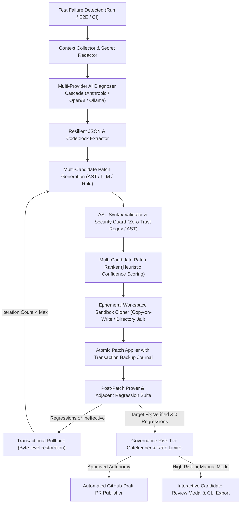

# PROOFix AI Diagnosis & Self-Repair Loop Architecture

## Overview

The **AI Diagnosis & Self-Repair Loop** in **PROOFix** is an evidence-grounded, zero-trust autonomous code remediation subsystem. When an end-to-end browser check, layout overflow audit, or API fuzz test encounters a regression, the self-repair loop synthesizes sanitized failure context, analyzes root causes across multi-provider LLMs, generates multiple AST-valid candidate patches, verifies fixes inside isolated ephemeral sandboxes, and publishes verified pull requests or copy-paste CLI scripts with transactional rollback guarantees.

---

## Architecture Pipeline



---

## 1. Multi-Provider AI Diagnosis Cascade

* **Resilient Provider Dispatch**: Supports Anthropic Claude 3.5 Sonnet / Haiku, OpenAI GPT-4o / GPT-4o-mini, and local air-gapped LLMs (Ollama / vLLM / LocalAI) with automatic failover cascades.
* **Leak-Proof Prompt Context**: Redacts bearer tokens (`sk-ant-*`, `Bearer *`, `ghp_*`), database connection strings, and SSH private keys before prompt ingestion.
* **Resilient JSON Parser**: Extracts clean JSON even when wrapped in Markdown backticks (```` ```json ````) or preceded by conversational chatter.

---

## 2. AST Syntax Validation & Prohibited Security Pattern Guard

* **AST Syntax Checking**: Analyzes TypeScript, TSX, JSX, and JavaScript unified diff hunks prior to workspace injection, verifying brace, bracket, and JSX element balance.
* **Prohibited Code Scanner**: Blocks dynamic command spawning (`child_process`, `execSync`), code evaluation (`eval()`, `new Function()`), prototype pollution (`__proto__`), and system path escapes (`/etc/passwd`, `C:\Windows\System32`).
* **Protected File Shield**: Prohibits patches from modifying `.env*`, `.git/**`, `.github/workflows/**`, `id_rsa`, or root lockfiles without administrative overrides.

---

## 3. Multi-Candidate Synthesis & Heuristic Ranking

* **Candidate Strategies**:
  * `ast_targeted`: Surgical localized fixes (e.g. optional chaining `?.`, safe navigation).
  * `llm_guided`: Semantic refactorings and fallback boundary logic.
  * `rule_deterministic`: Deterministic route creation and accessible label generation.
* **Heuristic Scoring**:
  * Baseline 70 + bonus for error boundary wrappers (`try/catch`) and null-safety operators (`?.`, `??`).
  * Penalties for large line counts, multiple target files, or complex imports.
  * Selection formula: `Composite = 0.6 * ConfidenceScore + 0.4 * HeuristicScore`.

---

## 4. Ephemeral Workspace Isolation & Symlink Jail

* **Disposable Workspaces**: Sandboxed directory clones provisioned under `data/ephemeral_workspaces/` with copy-on-write isolation. The source checkout remains strictly immutable.
* **Symlink Jail Enforcement**: Resolves realpaths to ensure symlinks cannot escape the isolated directory root (`verifyPathSecurity`).
* **Disk Quota Guard**: Enforces configurable maximum disk quotas (default 500MB) and lifetime timeouts (default 15 minutes).

---

## 5. Post-Patch Verification Prover

* **Target Fix Verification**: Re-runs the exact failing check against the patched workspace to verify that the root cause (e.g. HTTP 404, uncaught TypeError, missing accessible label) has been resolved.
* **Adjacent Regression Suite**: Executes neighboring tests across the application to verify that the patch introduced zero unintended side effects.
* **Structured Proving Report**: Records `PatchProvingOutcome`:
  * `'verified_fix'`: Target resolved, 0 regressions.
  * `'regression_detected'`: Target resolved, but secondary failures triggered.
  * `'failed'`: Target failure persists.

---

## 6. Transactional Patch Application & Rollback Journal

* **Atomic Application**: Validates all hunks before writing any bytes to disk.
* **Backup Entries**: Captures SHA256 hashes and original byte contents of every touched file.
* **Inverted Reverse-Diff**: Automatically synthesizes reverse unified diffs with inverted operators (`+` <-> `-`).
* **Transactional Rollback**: Reverts all modified files and removes newly created files byte-for-byte in constant time if verification fails.

---

## 7. Governance Risk Tiers & Rate Limiting

| Risk Tier | Scope | Auto-Apply Policy |
|:---|:---|:---:|
| **Tier 1 (Low)** | CSS, SCSS, Markdown, localized alt text | Permitted if score >= 90% |
| **Tier 2 (Medium)** | UI components, React hooks, helper functions | Permitted if score >= 80% & green test |
| **Tier 3 (High)** | API route handlers, database schemas, configs | Human review or Draft PR required |
| **Tier 4 (Critical)** | Auth, sessions, cryptography, payment logic | Silent auto-apply strictly blocked |

* **Rate Limiter**: Maximum 12 automated repairs per hour per project; triggers automatic 10-minute cooldown if 3 consecutive failures occur.

---

## 8. Interactive UI & GitHub PR Integration

* **Patch Candidate Review Modal** (`src/components/repair/PatchCandidateReviewModal.tsx`):
  * Multi-candidate tabbed selector with strategy and confidence badges.
  * Colored unified diff viewer with addition/deletion highlighting.
  * One-click controls: *Apply in Sandbox*, *Verify Fix Prover*, *Publish GitHub PR*, *Rollback*.
* **Automated Pull Request Publisher** (`src/lib/repair/github-publisher.ts`):
  * Creates dedicated branch: `proofix/heal-<runId>-<proposalId>`.
  * Generates rich Markdown body with root cause diagnosis, AST security badge, and regression table.
  * Provides copy-paste local Git CLI command fallback when unauthenticated.

---

## 9. Verification & Master CI Suite

Execute the master AI Diagnosis & Self-Repair Loop CI suite anytime via:

```bash
npm run test:ai:repair
```

**Verification Results:**
* `10 Passed, 0 Failed` across all 10 stages.
* 100% clean TypeScript compilation (`tsc --noEmit`).
