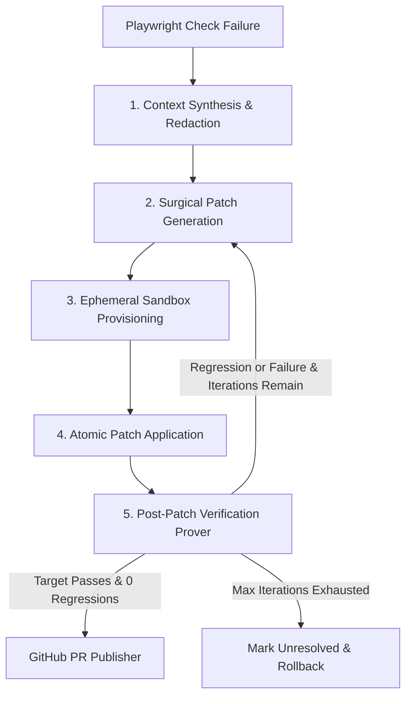

# PROOFix Autonomous Self-Healing & Verified Pull Request Loop (Contributions 101–110)

The **PROOFix Autonomous Self-Healing Engine** automatically extracts failure context from broken Playwright browser verification runs, synthesizes surgical code patches, safely validates them inside isolated ephemeral sandbox workspaces, verifies zero regressions against adjacent checks, and publishes audited GitHub Pull Requests.

---

## Architecture & Contributions (101–110)

| Contribution | Component / Module | Description |
|:---:|:---|:---|
| **101** | `src/lib/types/self-healing.ts`<br>`src/lib/repair/self-healing-policy.ts` | Type definitions, validated policy settings (`semi_autonomous`, `fully_autonomous`, `manual_approval`), iteration limits, and precondition security guards. |
| **102** | `src/lib/repair/context-synthesizer.ts`<br>`src/lib/security/redactor.ts` | Multi-source failure context synthesis (Playwright logs, DOM snapshots, stack traces) with leak-proof credential and API token redaction. |
| **103** | `src/lib/repair/patch-generator.ts` | Surgical unified diff patch generator, confidence score calculator (0–100), and strict prohibited shell command / dangerous script injector defenses. |
| **104** | `src/lib/repair/ephemeral-workspace.ts` | Isolated filesystem sandboxing under `data/workspaces/heal_*` with full repository snapshot creation and atomic instant rollback. |
| **105** | `src/lib/repair/patch-applier.ts` | Atomic patch applier with multi-line context matching, drift detection, and immediate rollback upon conflict or non-matching hunks. |
| **106** | `src/lib/repair/patch-prover.ts` | Post-patch verification prover that re-executes the target failed browser check in the sandbox and verifies that adjacent checks encounter 0 regressions. |
| **107** | `src/lib/repair/healing-orchestrator.ts` | Multi-iteration convergence loop orchestrating candidate ranking, candidate proving, regression handling, and iteration budget limits. |
| **108** | `src/lib/repair/github-publisher.ts` | GitHub integration creating isolated branch namespaces (`proofix/heal-*`), markdown-formatted PR bodies with redacted logs, and draft PR options. |
| **109** | `src/components/repair/SelfHealingDashboard.tsx`<br>`src/app/projects/[id]/runs/[runId]/page.tsx` | Interactive UI featuring a 5-stage pipeline tracker, diff inspection modal, iteration timeline, prover telemetry logs, and manual review approval actions. |
| **110** | `tests/verify-self-healing-ci.mjs`<br>`package.json` | Master CI regression suite validating all 10 self-healing stages end-to-end, integrated into `npm run test:self-healing`. |

---

## 1. Safety & Security Invariants

1. **Checkout Immutability**:
   The user's original repository is never modified directly during self-healing exploration. All operations occur in isolated ephemeral clones.
2. **Zero Secret Leakage**:
   All logs, DOM attributes, network request headers, and stack traces pass through `redactSensitiveData` before entering prompt context, PR descriptions, or dashboard displays. Tokens matching patterns such as `ghp_*`, `gho_*`, `eyJ*`, private keys, and authorization headers are replaced with `[REDACTED_SECRET]`.
3. **Sandbox Isolation**:
   Ephemeral sandbox workspaces are created under dedicated disposable directories (`data/workspaces/heal_<session-id>`) with automated cleanup and snapshot rollback upon patch rejection.
4. **Injection Defenses**:
   Generated patches are validated against a blocklist of dangerous patterns (`child_process`, `execSync`, `curl | sh`, `rm -rf`, `powershell -enc`). Violations trigger an immediate abort.
5. **Zero-Regression Proof Invariant**:
   A patch is never declared a `verified_fix` unless:
   - The targeted failing browser check executes and transitions to `passed`.
   - All adjacent and regression checks execute with zero new failures.

---

## 2. 5-Stage Execution Pipeline



---

## 3. Operational Modes

- **`manual_approval`**: The self-healing loop synthesizes and proves the fix inside the ephemeral sandbox, but requires manual confirmation on the dashboard before opening a PR.
- **`semi_autonomous` (Default)**: Automatically provisions sandboxes, generates patches, verifies zero regressions, and opens a GitHub Draft Pull Request for human review.
- **`fully_autonomous`**: Automatically creates and opens a ready-to-merge Pull Request once the post-patch prover passes with 0 regressions.

---

## 4. Master CI Verification

Run the complete self-healing test suite:

```bash
npm run test:self-healing
```

Or run the specific unit test suites:
- `node tests/self-healing-config.test.mjs` (Policy & guards)
- `node tests/failure-context-synthesizer.test.mjs` (Context synthesis & redaction)
- `node tests/patch-generator-engine.test.mjs` (Patch generation & safety)
- `node tests/ephemeral-workspace-manager.test.mjs` (Sandbox & snapshots)
- `node tests/atomic-patch-applier.test.mjs` (Atomic applier & conflict detection)
- `node tests/post-patch-prover.test.mjs` (Prover & regression detection)
- `node tests/multi-iteration-healing.test.mjs` (Multi-iteration orchestration)
- `node tests/github-pr-publisher.test.mjs` (PR creation & markdown body)
- `node tests/self-healing-ui.test.mjs` (Dashboard UI component)
