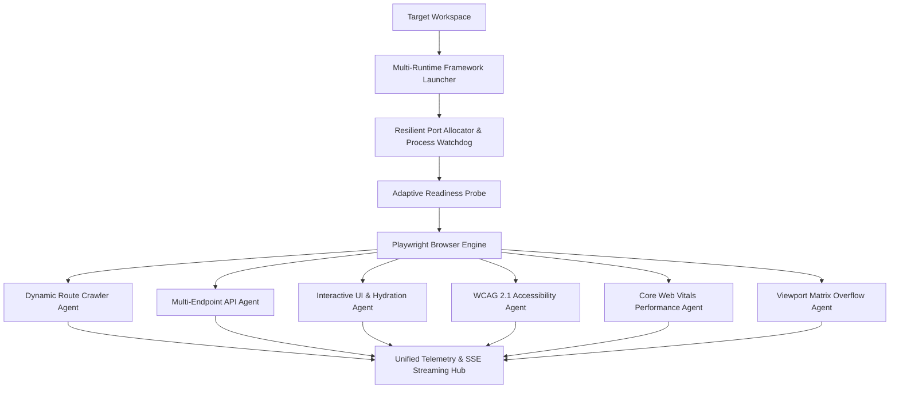

# Core Execution and Testing Agents Architecture

## 💡 Overview

The **PROOFix Core Execution & Testing Engine** has been re-architected from a static Next.js test runner into a **dynamic, multi-runtime, multi-agent automated software verification platform**.

Rather than relying on hardcoded route checks or framework assumptions, PROOFix employs specialized browser testing and process execution agents that autonomously explore, test, and audit any web application.

---

## 🏗️ The 6 Autonomous Testing Subsystems



---

### 1. Multi-Runtime Execution & Process Launcher

* **Framework Inferrer**: Detects Next.js, Vite, Create React App, Remix, Vue CLI, SvelteKit, Astro, Express, Fastify, or Static builds.
* **Package Manager Resolver**: Supports `npm`, `pnpm`, `yarn`, and `bun`.
* **Dynamic Port Allocator**: Probes TCP socket availability in the `4173..4999` range, automatically detects collisions, and reallocates clean ports.
* **Process Watchdog**: Tracks child process trees (`ChildProcess`) and guarantees recursive force-kill cleanup (`taskkill /f /t` on Windows, `kill(-pid)` on Unix) to prevent orphaned Node/Chromium processes.
* **Adaptive Readiness Probe**: Uses HTTP GET/HEAD requests with exponential backoff and jitter to wait for server readiness without socket stampedes.

---

### 2. Dynamic Route Discovery & Navigation Crawler Agent

* **Anchor Link Discovery**: Scans DOM trees for `<a href>` elements, strictly enforcing same-origin URL boundaries.
* **Path Normalizer**: Normalizes trailing slashes, strips query parameters and hash anchors, and ignores non-navigational links (`javascript:`, `mailto:`, `tel:`).
* **Dynamic Route Parameter Synthesizer**: Identifies parameterized Next.js and Express tokens (`[id]`, `[slug]`, `[...catchAll]`, `:userId`) and synthesizes valid mock navigation values (`/products/1`, `/blog/sample-item`, `/docs/overview`).
* **Dead-Link Auditor**: Navigates to discovered routes, traps HTTP 404/500/redirect errors, captures full error state screenshots, and formats structured findings.
* **Navigation Timing**: Measures TTFB, DOMContentLoaded, and SPA client transition latencies.

---

### 3. Backend API Verification Agent

* **Endpoint Discovery**: Extracts all API routes from app route manifests and determines supported HTTP verbs (`GET`, `POST`, `PUT`, `DELETE`, `PATCH`).
* **Semantic Synthetic Payloads**: Generates context-aware JSON payloads (auth credentials, user models, product items) to prevent empty-body crashes.
* **Error Leak Detector**: Flags responses leaking internal uncaught stack traces or database connection strings (`ECONNREFUSED`, SQL syntax errors).

---

### 4. Interactive UI & State Hydration Agent

* **Interactive Scanner**: Discovers clickable buttons, text inputs, checkboxes, selects, and elements with `role="button"` or `role="tab"`.
* **Zero-Trust Safety Guardrails**: Detects destructive keywords (`delete`, `drop`, `pay`, `purchase`, `cancel subscription`) and blocks them from dispatching, ensuring safe execution on production-like data.
* **Hydration Verifier**: Detects React SSR mismatch errors (`Text content did not match`, `Hydration failed`) and monitors DOM mutations after event dispatch.

---

### 5. Accessibility & Core Web Vitals Quality Auditing

* **WCAG 2.1 Level AA Scanner**: Audits missing image `alt` attributes, unlabelled form inputs, and positive `tabindex > 0` keyboard traps.
* **Core Web Vitals**: Measures Time to First Byte (TTFB), First Contentful Paint (FCP), Largest Contentful Paint (LCP), and Cumulative Layout Shift (CLS).
* **Resource Budgets**: Compares script, stylesheet, and image transfer weights against performance budgets.

---

### 6. Viewport Matrix & Telemetry Broadcaster

* **Multi-Device Matrix**: Audits layouts across Compact Mobile (360px), iPhone 14 (390px), iPad Air (820px), and Standard Desktop (1280px).
* **Horizontal Overflow Detector**: Pinpoints the exact DOM element (`getBoundingClientRect().right > window.innerWidth`) causing unintentional horizontal scrolling.
* **SSE Telemetry Hub**: Streams real-time verification logs, test steps, screenshots, and findings to web clients with heartbeat keepalive.

---

## 🧪 CI Verification

Execute the complete Core Execution & Testing Agents verification suite:

```bash
npm run test:execution
```
