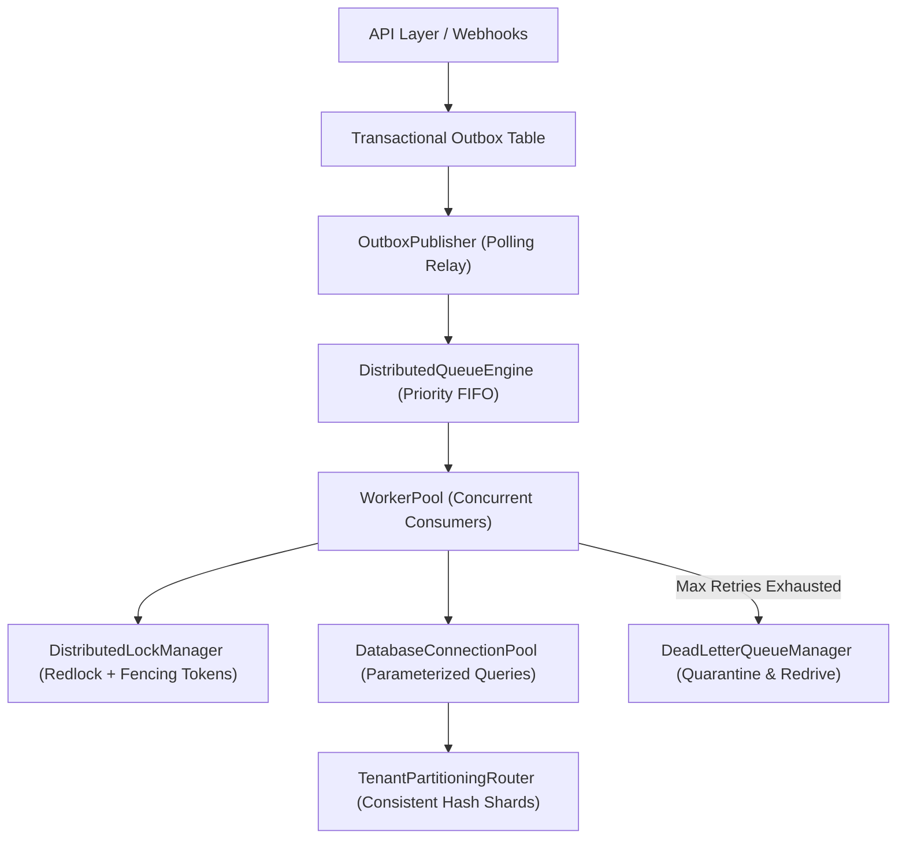

# PROOFix Production Database & Distributed Queue Architecture

## Overview
PROOFix Production Database & Distributed Queue Architecture (Contributions 161–170) provides a fault-tolerant, horizontally scalable asynchronous backbone designed to handle millions of test jobs, visual regression diffs, API fuzzing tasks, and self-healing PR cycles with at-least-once delivery, zero data loss, and strict multi-tenant isolation.

---

## 1. System Architecture



---

## 2. Key Pillars

### 2.1 Priority-Aware FIFO Queuing with Visibility Timeouts
- **Priority Weights**: `critical` (P1) > `high` (P2) > `normal` (P3) > `low` (P4).
- **Visibility Leases**: Workers lease jobs with an expiration timestamp (`leaseExpiresAt`). If a worker crashes, the visibility timeout lapses and the job is automatically re-leased to a healthy worker.
- **Heartbeat Renewals**: Active long-running jobs periodically extend leases (`renewLease`) to avoid false timeouts.

### 2.2 Exponential Backoff with Full Jitter
To mitigate thundering herds across external downstream APIs and microVM spawns, retries calculate delay via randomized full jitter:
$$\text{delay} = \text{random}(0, \min(\text{maxDelayMs}, \text{baseDelay} \times 2^{\text{attempt}}))$$

### 2.3 Dead-Letter Queue (DLQ) & Redrive Console
- Quarantines unrecoverable poison jobs after `maxRetries` is reached.
- Captures stack traces, failure reasons, and timestamps.
- Enables single-click manual or automated redrive back into the active queue.

### 2.4 Transactional Outbox Pattern
Guarantees database consistency without two-phase commit (2PC):
1. Domain state mutation and outbox event are written within a single database transaction.
2. Background publisher continuously relays pending outbox events to the queue.

### 2.5 Distributed Locks with Monotonic Fencing Tokens
Implements distributed mutual exclusion with Martin Kleppmann's fencing token algorithm. Each lock acquisition increments a monotonic sequence number; storage engines reject any write presenting an outdated fencing token.

### 2.6 Multi-Tenant Partitioning & Sharding
- Deterministic MD5 consistent hash ring maps tenants to regional cluster shards.
- Query isolation guards reject any query lacking tenant-level scoping (`WHERE tenant_id = $1` or schema qualification).

---

## 3. Verification
Run the master distributed queue test suite:
```bash
npm run test:queue
```
