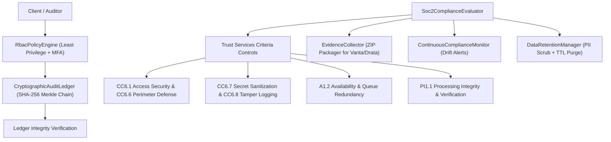

# PROOFix Enterprise Governance, RBAC & SOC2 Compliance Architecture

## Overview
PROOFix Enterprise Governance, RBAC & SOC2 Compliance Architecture (Contributions 171–180) provides the security, privacy, and continuous audit controls required by enterprise security teams and third-party auditors (SOC2 Type II, ISO 27001, HIPAA, GDPR).

---

## 1. Compliance Architecture



---

## 2. Core Capabilities

### 2.1 Granular Role-Based Access Control (RBAC)
- Five distinct enterprise roles:
  - `super_admin`: Full cluster management.
  - `security_auditor`: Read-only access to audit logs, compliance reports, and evidence packages.
  - `qa_lead`: Authorized to approve autonomous self-healing PRs and configure replay cassettes.
  - `developer`: Authorized to trigger test runs and fuzzing probes within assigned tenant.
  - `viewer`: Read-only observer.
- **MFA Step-Up**: Required for sensitive operations (`healing:approve`, `secrets:manage`, `audit:export`).
- **Tenant Scoping Guard**: Prevents cross-tenant data access.

### 2.2 Tamper-Evident Cryptographic Audit Ledger
- Immutable append-only log ledger where every entry calculates:
  $$\text{entryHash} = \text{SHA-256}(\text{previousHash} \parallel \text{sequence} \parallel \text{timestamp} \parallel \text{actor} \parallel \text{action} \parallel \text{details})$$
- Mathematical verification detects retrospective data modification or record deletion.

### 2.3 Automated SOC2 Type II Control Evaluation
Continuous assessment of Trust Services Criteria:
- **CC6.1**: RBAC boundaries & MFA enforcement.
- **CC6.6**: Perimeter defenses & link-local cloud metadata blocking (169.254.169.254).
- **CC6.7**: Secret scrubbing and token redaction.
- **CC6.8**: Cryptographic audit trail integrity.
- **A1.2**: Distributed queue failover, visibility timeouts, and DLQ quarantine.
- **PI1.1**: Test verification gates on self-healing code synthesis.

### 2.4 Automated Evidence Packaging
One-click generation of auditor-ready ZIP bundles containing signed reports, verified audit ledgers, system security manifests, and SHA-256 checksums compatible with Vanta, Drata, and external audit firms.

### 2.5 Sensitive Data Redaction & Retention Lifecycles
- Automatic scrubbing of credit cards, SSNs, phone numbers, email addresses, and Bearer tokens.
- Automated TTL purges for test artifacts, session videos, and audit logs complying with GDPR right-to-erasure.

---

## 3. Verification
Run the master enterprise governance test suite:
```bash
npm run test:governance
```
