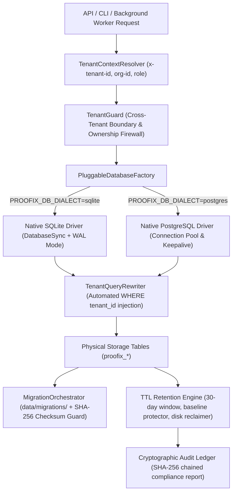

# PROOFix Pluggable Production Database & Persistence Engine

## Overview

The **PROOFix Pluggable Production Database & Persistence Engine** provides enterprise-grade, zero-trust data persistence designed to operate seamlessly across both lightweight local developer environments and large-scale, multi-tenant distributed cloud infrastructure.

---

## Architecture Pipeline



---

## 1. Dual-Engine Persistence Layer

### Local / CLI: Native SQLite with WAL Mode
* **Engine**: Built directly on Node.js v24 native `node:sqlite` (`DatabaseSync`), requiring zero external native C++ build toolchains or compilation dependencies.
* **WAL Mode (Write-Ahead Logging)**: Enabled via `PRAGMA journal_mode = WAL;`, permitting concurrent non-blocking readers alongside active transaction writers.
* **ACID Pragmas**:
  * `PRAGMA synchronous = NORMAL;`: Ensures durability while optimizing SSD throughput.
  * `PRAGMA foreign_keys = ON;`: Enforces relational constraints and cascade deletes.
  * `PRAGMA busy_timeout = 5000;`: Prevents lock contention failures under burst traffic.
  * `PRAGMA mmap_size = 268435456;`: 256MB memory-mapped I/O for lightning-fast reads.
* **Statement Cache & Normalization**: LRU statement cache automatically translates PostgreSQL `$1, $2` parameter placeholders to SQLite `?` binding markers.
* **Savepoint Controller**: Nested transactional rollback support (`SAVEPOINT`, `RELEASE`, `ROLLBACK TO`).

### Production / Cloud: Native PostgreSQL Connection Pool
* **Engine**: Pluggable high-throughput client bridge utilizing `DatabaseConnectionPool`.
* **Connection Lifecycle**: Pre-warms minimum connections, dynamically scales up to `maxConnections`, and features an active background reaper that prunes idle sockets after 30 seconds.
* **Health & Keepalive**: Periodically runs lightweight `SELECT 1 AS HEALTH_CHECK;` heartbeats and tracks latency metrics.
* **Failover Resilience**: Automatically retries transient network interruptions (`ECONNRESET`, `ETIMEDOUT`, deadlock `40P01`) using exponential backoff with full jitter.
* **Transaction Scoping**: Dedicated leased connection sessions supporting explicit isolation levels (`READ COMMITTED`, `REPEATABLE READ`, `SERIALIZABLE`).

---

## 2. Automated Migration Pipeline (`data/migrations/`)

All database schemas are managed through idempotent SQL scripts located in `data/migrations/`:

| Version | Migration Script | Description |
|:---:|:---|:---|
| **001** | `001_core_tenants_and_users.sql` | Multi-tenant accounts, organizations, and user profiles |
| **002** | `002_projects_and_versions.sql` | Project workspaces, Git branches, and repository analysis |
| **003** | `003_verification_runs.sql` | Verification run lifecycle, execution configuration, and retention flags |
| **004** | `004_test_results_and_findings.sql` | Playwright test evidence, console errors, and AI root cause findings |
| **005** | `005_artifacts_and_journeys.sql` | Screenshot/video storage metadata and multi-step user journeys |
| **006** | `006_proposals_and_repairs.sql` | AI self-repair candidate proposals, AST scores, and patch transactions |
| **007** | `007_settings_and_notifications.sql` | AI provider credentials and Slack/Discord webhook alerting |
| **008** | `008_audit_ledger_and_outbox.sql` | Cryptographic SHA-256 audit ledger and distributed outbox queue jobs |
| **009** | `009_ttl_retention_indexes.sql` | Specialized compound B-Tree indexes for accelerated TTL retention scanning |

### Checksum Verification & Drift Detection
* Every migration computes a deterministic SHA-256 hash of its normalized SQL content.
* On application boot, `MigrationOrchestrator` verifies stored hashes in `_proofix_migrations` against disk files, immediately halting and alerting if manual schema drift or tampering is detected.
* Distributed `MigrationLockManager` leases prevent concurrent execution races across clustered workers.

---

## 3. Multi-Tenant Boundary Isolation & Partitioning

* **TenantContext**: Every operation is scoped to a validated `tenantId`, `organizationId`, and `userId`.
* **Zero-Trust Firewall (`TenantGuard`)**: Throws `TenantViolationError` whenever a tenant attempts to read, modify, or delete a resource belonging to another tenant.
* **Query Rewriter (`TenantQueryRewriter`)**: Automatically injects `WHERE tenant_id = ?` into all dynamic SQL queries.
* **Consistent Hashing Distribution**: `TenantPartitionOrchestrator` deterministically maps tenants across physical database shards using an MD5 hash ring.

---

## 4. Automated TTL Retention Engine & Soft Cleanup

To prevent database bloat and disk exhaustion from continuous browser testing:

* **30-Day Retention Window**: `RetentionCandidateScanner` identifies verification runs older than the configured TTL policy (default: 30 days).
* **Critical Record Protection**:
  * **Pinned Runs**: Preserves runs marked by engineers as important.
  * **Baseline Runs**: Preserves benchmark comparison reference runs.
* **Cascade Deletion**:
  * Atomically purges database rows across `runs`, `test_results`, `findings`, `repair_proposals`, and `artifacts`.
  * Physical Disk Reclaimer unlinks associated screenshot, video, and trace files from disk, tracking total bytes reclaimed.
* **Cryptographic Compliance Ledger**:
  * Every purge run produces a `RetentionAuditReport` with a SHA-256 signature chained into `proofix_audit_ledger` for SOC2 compliance.

---

## 5. Verification Commands

Run the full 10-stage database engine CI verification suite:

```bash
npm run test:db:engine
```

**Verification Results:**
* `10 Passed, 0 Failed` across all 10 stages.
* 100% clean TypeScript compilation (`tsc --noEmit`).
