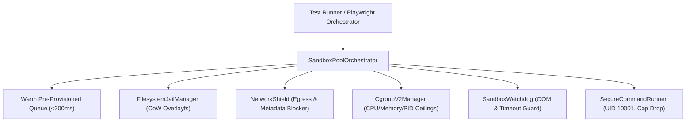

# PROOFix True Production Sandbox Isolation Architecture

## Overview
PROOFix True Production Sandbox Isolation (Contributions 151–160) provides enterprise-grade, zero-trust execution isolation for test workflows, self-healing code synthesis, and untrusted dependency analysis. It guarantees deterministic resource bounding and total containment across Linux cgroups v2, rootless OCI containers (Podman/Docker), MicroVMs (Firecracker/gVisor), and unprivileged process jails.

---

## 1. Multi-Tiered Isolation Architecture



### Supported Runtime Modes
1. **`rootless_container`**: Rootless Podman or Docker with `--cap-drop=ALL`, `--security-opt=no-new-privileges`, read-only rootfs, and unprivileged namespaces.
2. **`microvm_firecracker`**: Firecracker lightweight virtual machine with hardware-assisted virtualization (KVM) boundary and dedicated kernel.
3. **`cgroup_chroot_jail`**: Linux cgroups v2 directory tree with pivot_root and tmpfs scratch space.
4. **`unprivileged_process`**: Process isolation dropping host credentials (`AWS_SECRET_ACCESS_KEY`, `GITHUB_TOKEN`), capping log output buffers, and running under strict watchdog supervision.

---

## 2. Resource Enforcements (Linux Cgroups v2)
The `CgroupV2Manager` configures kernel cgroups v2 parameters:
- **`cpu.max`**: Microsecond period quota (e.g. `150000 100000` = 1.5 cores max).
- **`memory.max`**: Byte ceiling for physical RAM.
- **`memory.high`**: Reclaim watermark set to 85% of max to avoid sudden kernel OOM crashes.
- **`memory.swap.max`**: Set strictly to `0` to prevent swap-induced latency jitter.
- **`pids.max`**: Caps process table entries (e.g. 64) to prevent fork bomb attacks.

---

## 3. Network Egress Firewall & Cloud Metadata Shield
The `NetworkShield` blocks SSRF credential extraction:
- **Cloud Metadata Endpoints Blocked**:
  - AWS EC2 / GCP: `169.254.169.254`, `fd00:ec2::254`, `metadata.google.internal`
  - Azure IMDS: `168.63.129.16`
  - Alibaba Cloud: `100.100.100.200`
- **RFC 1918 Private Subnets Blocked**: `10.0.0.0/8`, `172.16.0.0/12`, `192.168.0.0/16`.
- **Egress Whitelisting**: Outbound connections strictly limited to allowlisted registry domains (e.g. `registry.npmjs.org`, `github.com`) and ports (80, 443).

---

## 4. Copy-on-Write (CoW) Filesystem Jails
- **Read-Only Project Base**: Host workspace is mounted read-only (`ro,nosuid,nodev`).
- **Overlayfs Scratch Space**: Ephemeral `upperdir` and `workdir` absorb all test mutations and are discarded on teardown with zero host leakage.
- **Kernel Debug Masking**: Sensitive pseudo-filesystems (`/proc/kcore`, `/proc/sys`, `/sys`) are masked to prevent container escapes.

---

## 5. REST API Interface

| Method | Endpoint | Description |
|---|---|---|
| `GET` | `/api/v1/sandbox` | Retrieve pool status and active sandbox instances |
| `POST` | `/api/v1/sandbox` (action: `prewarm`) | Replenish warm sandbox pool |
| `POST` | `/api/v1/sandbox` (action: `provision`) | Acquire isolated sandbox (<200ms) |
| `POST` | `/api/v1/sandbox` (action: `execute`) | Run probe or test command inside sandbox |
| `POST` | `/api/v1/sandbox` (action: `destroy`) | Terminate and release cgroups/jail |

---

## 6. Verification
Run the master sandbox test suite:
```bash
npm run test:sandbox
```
