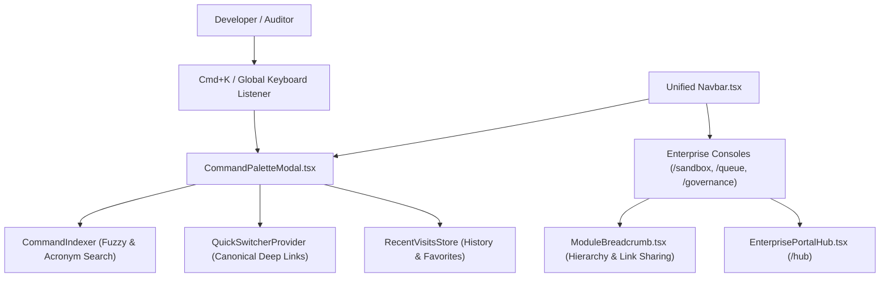

# PROOFix Unified Enterprise Navigation Hub & Command Palette

## Overview
The Unified Enterprise Navigation Hub (Contributions 181–190) transforms PROOFix into a unified operations mission control. It bridges all 8 platform pillars with a global keyboard-first Command Palette (`Cmd+K`), quick-switchers, deep link generators, and contextual breadcrumbs.

---

## 1. Core Architecture



---

## 2. Key Capabilities

### 2.1 Global Command Palette (`Cmd+K` / `Ctrl+K`)
- Fuzzy search scoring indexing titles, subtitles, keywords, and acronyms (e.g. `dlq` matches Dead-Letter Queue).
- Keyboard navigation with `↑`, `↓`, `Enter`, and `Esc`.
- Category tabs: Core, Enterprise, Testing, Security, Operations.

### 2.2 Unified Enterprise Navigation Bar
- Top-level links for Core (`Dashboard`, `Projects`) and Enterprise portals:
  - 🛡️ **Sandbox** (`/sandbox`)
  - ⚡ **Queues & DB** (`/queue`)
  - 📜 **SOC2 & Governance** (`/governance`)
- Quick trigger search button with `<kbd>⌘K</kbd>` badge.

### 2.3 Keyboard Shortcut Registry & Cheat Sheet (`?`)
- Interactive modal triggered by pressing `?` documenting all platform keybindings (`g d`, `g x`, `g q`, `g g`, `t r`, `t f`, `e e`).

### 2.4 Deep Linking & Contextual Breadcrumbs
- Deterministic resource link generator (`/projects/:id/runs/:id`, `/sandbox?focus=:id`, `/queue?tab=dlq&jobId=:id`).
- 1-click URL sharing button with clipboard confirmation.

---

## 3. Verification
Run the master navigation test suite:
```bash
npm run test:navigation
```
